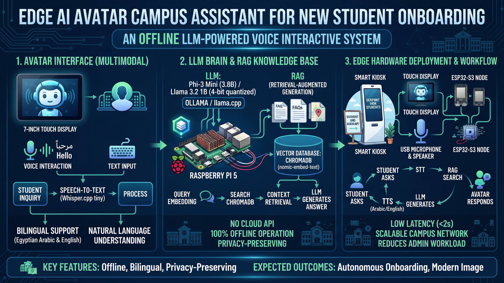

cd C:\campus_assistant

@"
# Edge AI Avatar Campus Assistant for New Student Onboarding
**An Offline LLM-Powered Voice Interactive System**



## Project Overview
This project is an intelligent, 100% offline, Edge AI-powered campus assistant designed to welcome and guide new students. Acting as a virtual receptionist, it understands student inquiries in both **voice and text (Egyptian Arabic & English)** and provides instant, grounded responses about admission, departments, schedules, campus facilities, and academic regulations without requiring an internet connection.

Unlike cloud-based chatbots, all AI inference runs locally on edge hardware (**Raspberry Pi 3/4/5**), ensuring student data privacy, low latency (**<2s**), and 24/7 availability.

---

## Problem Statement & Objectives
* **Problem:** First-batch students face a lack of guidance and overload administrative staff with repeated questions (*Where is my lecture hall? What are the required documents? What is the difference between departments?*).
* **Objectives:**
  1. Design an offline AI assistant using a quantized Large Language Model (LLM) running on edge hardware.
  2. Implement a multimodal interface supporting Voice-to-Text and Text-to-Voice interaction.
  3. Deliver accurate, context-aware answers using Retrieval-Augmented Generation (RAG) to prevent hallucinations.
  4. Deploy on a standalone, low-cost, low-power smart kiosk.

---

## System Architecture

### Hardware Layer
* **Main Edge Server:** Raspberry Pi 4B / 5 (8GB RAM)
* **Peripherals:** 7-inch Touch Display + USB Microphone & Speaker
* **Optional Distributed Nodes:** ESP32-S3 modules connected via MQTT

### Software Layer (Full Edge AI Stack)
* **Speech-to-Text (STT):** ``whisper.cpp`` (``tiny`` / ``base`` model) for offline Arabic & English transcription
* **LLM Brain:** ``qwen2.5:1.5b-instruct-q4_K_M`` (4-bit quantized, custom ``campus-assistant`` model via Ollama / ``llama.cpp``)
* **Knowledge Base (RAG):** Faculty bylaws, FAQs, and lecture materials embedded with ``nomic-embed-text`` inside a local **ChromaDB** vector store
* **Text-to-Speech (TTS):** Offline Arabic & English voice synthesis consuming sentence-level token streams
* **Interface:** Python Flask API & Kiosk Web UI

### End-to-End Workflow
``Student Asks (Voice/Text)`` ➔ ``Whisper STT`` ➔ ``ChromaDB RAG Search`` ➔ ``Ollama LLM Generates Grounded Answer`` ➔ ``TTS Voice + Touch Display``

---

## Key Features & Expected Outcomes
* **100% Offline & Privacy-Preserving:** Zero cloud API calls; student queries never leave the device.
* **Bilingual Multimodal Support:** Understands and responds in both Egyptian Arabic and English via voice or touch.
* **Low Latency (<2s):** Sentence-chunked HTTP streaming starts speaking immediately while remaining tokens generate.
* **Expected Outcomes:** Autonomous student onboarding at the faculty entrance, reducing administrative workload by ~60%.

---

## Repository Structure & Quick Start
* ``campus_assistant/llm_server.py`` — Local Flask streaming API (``/health``, ``/ask_stream``, ``/chat``)
* ``campus_assistant/rag_inference.py`` — ChromaDB semantic search + sentence-level Ollama streaming
* ``campus_assistant/ingest_data.py`` — Recursive PDF/JSON/CSV/TXT chunker and ``nomic-embed-text`` indexer
* ``campus_assistant/Modelfile.txt`` — Custom ``campus-assistant`` guardrail & bilingual system prompt

### Run Locally
````bash
cd campus_assistant
pip install ollama chromadb flask pypdf requests
ollama pull nomic-embed-text
ollama pull qwen2.5:1.5b-instruct-q4_K_M
ollama create campus-assistant -f Modelfile.txt
python ingest_data.py
python llm_server.py
